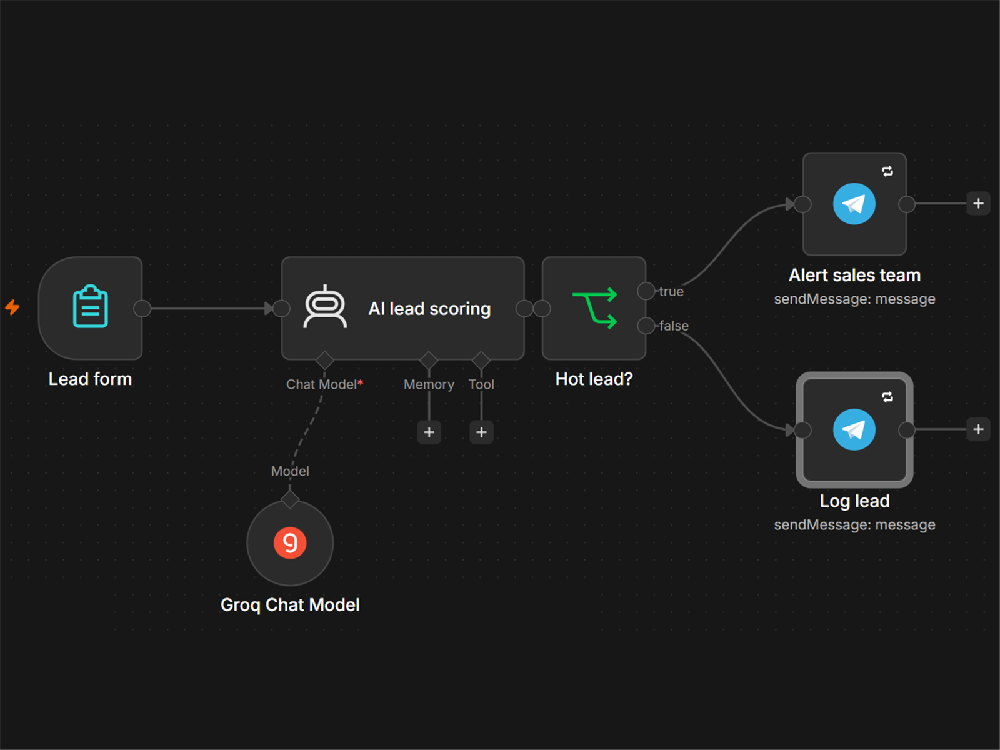
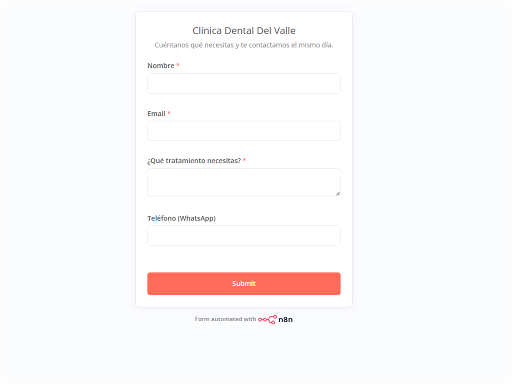
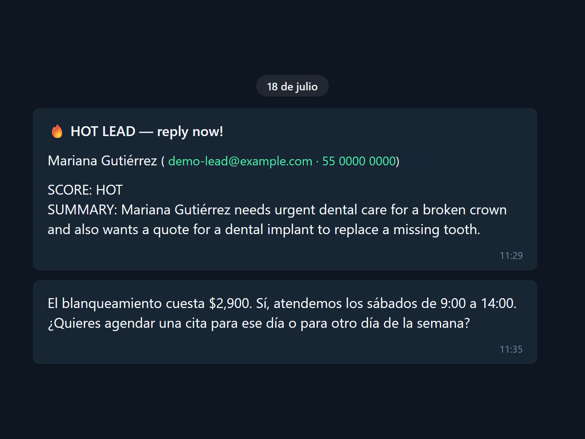

# AI Lead Scoring & Support Assistant — n8n + Groq + Telegram

Working demo of an AI-powered intake pipeline for a small business (a fictional dental clinic), built entirely in self-hosted n8n. Two importable workflows, no custom infrastructure:

1. **Lead Capture Form → AI Scoring → Sales Alert** — an n8n form captures the lead, an AI Agent node (Groq-hosted LLM) scores it **HOT/COLD** against explicit business rules, and hot leads fire an instant Telegram alert to the sales team while cold leads are logged for nurturing.
2. **Webhook Q&A Assistant** — the same stack exposed as a webhook: customer questions come in, the agent answers over Telegram using the business profile in its system prompt (prices, hours, services).



## How it works

```
Lead form → AI lead scoring (Groq LLM) → Hot lead? ──true──→ Alert sales team (Telegram)
                                                   └─false─→ Log lead (Telegram)
```

The scoring prompt returns a strict `SCORE: HOT|COLD` plus a one-line summary, so the IF branch works on plain text — no fragile JSON parsing. Every external call (LLM, Telegram) has retry-on-fail configured; API keys live in n8n's credential store, never in the workflow.

| Lead comes in | Sales gets this |
|---|---|
|  |  |

## Try it

1. Import both JSONs from [`workflows/`](workflows/) into n8n (UI import or `n8n import:workflow`).
2. Create two credentials: **Groq** (free tier works) and **Telegram** (a bot token from @BotFather), and select them in the agent/Telegram nodes.
3. Replace `YOUR_TELEGRAM_CHAT_ID` in the Telegram nodes with your own chat id.
4. Activate the workflow and submit the form — a HOT lead (urgent treatment, ready to book) should alert you on Telegram within seconds.

Built and run end to end on self-hosted **n8n 2.31.4** — the screenshots above are from real executions. The business is fictional; swap the system prompt's business profile to adapt it to any niche.

## Related

- [n8n Workflow Rescue Kit](https://github.com/guillemustafa-ux/n8n-workflow-rescue-kit) — five broken→fixed n8n workflow pairs you can import and verify yourself: the failure patterns this demo already guards against (retries, credential hygiene) and the ones that break workflows in the wild.

## License

MIT — see [LICENSE](LICENSE).
